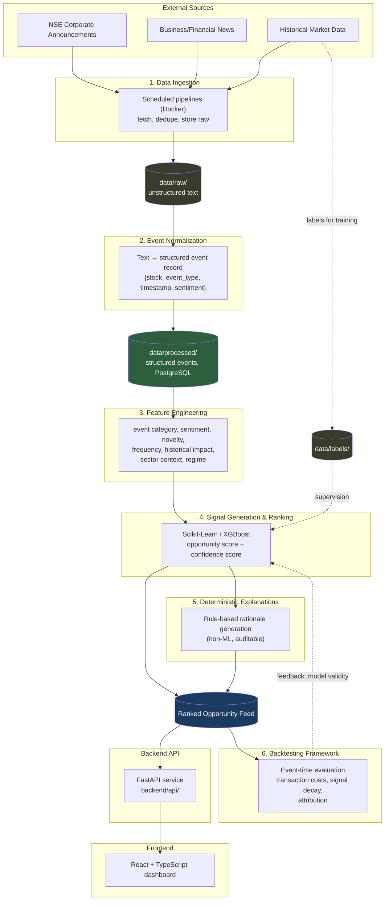

# Event-Driven Alpha Discovery Platform for Nifty 50

An event-driven quantitative research platform that transforms unstructured corporate announcements and business news into actionable stock signals for Indian equities.

The system continuously ingests market events, converts them into structured data, engineers predictive features, ranks opportunities across the Nifty 50 universe, and evaluates signal quality through rigorous event-time backtesting.

---

## Overview

Financial markets react to information long before traditional indicators capture the impact.

This project focuses on extracting alpha from:

- NSE corporate announcements
- Indian business and financial news

By converting these information streams into structured events, the platform aims to identify high-conviction opportunities and rank stocks based on expected future performance.

---

## Objectives

The platform is designed to:

- Ingest market-relevant events from multiple sources
- Normalize unstructured text into structured event records
- Generate predictive event-based features
- Score and rank opportunities across Nifty 50 stocks
- Assign confidence scores to signals
- Provide transparent, deterministic explanations
- Evaluate performance through realistic backtesting

---

## Market Scope

| Component | Details |
|------------|---------|
| Market | Indian Equities |
| Universe | Nifty 50 |
| Primary Data Sources | NSE Corporate Announcements, Business News |
| Signal Type | Event-Driven |
| Output | Ranked Opportunity Feed |
| Explanations | Deterministic & Data-Driven |
| Evaluation Method | Event-Time Backtesting |

---

## System Architecture



---

## Core Components

### 1. Data Ingestion

Responsible for collecting:

- NSE corporate announcements
- Financial news articles
- Historical market data

Key goals:

- Reliability
- Data quality
- Reproducibility

---

### 2. Event Normalization

Converts raw text into structured event records.

Examples:

- Earnings announcements
- Management changes
- Dividend declarations
- Acquisitions
- Regulatory actions
- Order wins
- Capacity expansions

Example output:

```json
{
  "stock": "RELIANCE",
  "event_type": "earnings",
  "timestamp": "2026-06-10T09:30:00Z",
  "sentiment": "positive"
}
```

---

### 3. Feature Engineering

Transforms events into machine-learning-ready features.

Potential features:

- Event category
- Event sentiment
- Event novelty
- Event frequency
- Historical event impact
- Sector context
- Market regime indicators

---

### 4. Signal Generation & Ranking

Models estimate the expected attractiveness of each opportunity.

Outputs include:

- Opportunity score
- Confidence score
- Supporting evidence
- Event metadata

---

### 5. Deterministic Explanations

Each signal includes transparent reasoning.

Example:

> Positive earnings surprise combined with historically favorable post-earnings performance and supportive sector momentum.

---

### 6. Backtesting Framework

Measures whether signals generate predictive value.

Focus areas:

- Event-time evaluation
- Realistic execution assumptions
- Transaction costs
- Signal decay analysis
- Performance attribution

---

## Technology Stack

### Backend

- Python
- FastAPI
- PostgreSQL

### Data & Machine Learning

- Pandas
- NumPy
- Scikit-Learn
- XGBoost

### Orchestration

- Scheduled pipelines
- Docker

### Frontend

- React
- TypeScript

### Deployment

- Docker
- Cloud Deployment (TBD)

---

## Project Roadmap

| Milestone | Status |
|------------|---------|
| Project Scope Finalized | ✅ Completed |
| README & Project Framing | ✅ Completed |
| Data Source Selection | 🚧 In Progress |
| Ingestion Pipeline | ⏳ Not Started |
| Event Normalization | ⏳ Not Started |
| Feature Engineering | ⏳ Not Started |
| Label Design | ⏳ Not Started |
| Baseline Model | ⏳ Not Started |
| Backtesting Framework | ⏳ Not Started |
| API Backend | ⏳ Not Started |
| Frontend Dashboard | ⏳ Not Started |
| Deployment | ⏳ Not Started |

---

## Current Development Focus

The project is being built incrementally with emphasis on:

1. Reliable data ingestion
2. Clean event normalization
3. Strong feature engineering
4. Rigorous backtesting
5. Simple and intuitive dashboards

---

## Repository Structure

```text
event-driven-alpha-platform/
│
├── backend/
│   ├── api/
│   ├── ingestion/
│   ├── events/
│   ├── features/
│   ├── models/
│   └── backtesting/
│
├── frontend/
│
├── data/
│   ├── raw/
│   ├── processed/
│   └── labels/
│
├── notebooks/
│
├── docs/
│
├── docker/
│
├── tests/
│
├── requirements.txt
├── docker-compose.yml
└── README.md
```

---

## Long-Term Vision

Build a production-grade event intelligence platform capable of discovering and ranking market opportunities from real-world information flows, enabling systematic and explainable investment decision-making for Indian equities.

---

## License

TBD.
